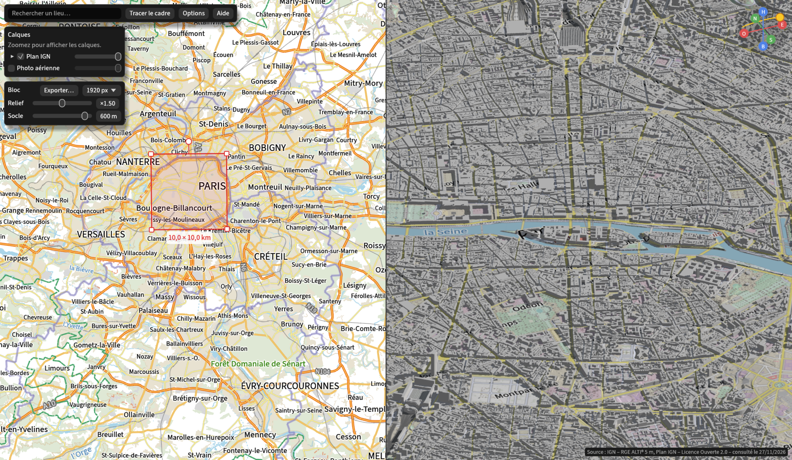
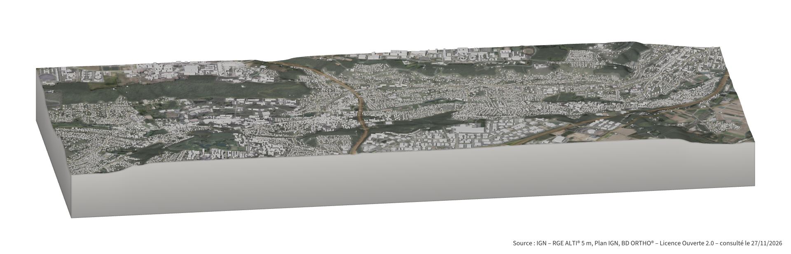

Blocs est une application qui génère des blocs diagrammes de paysages de France
métropolitaine à partir des données ouvertes de l'IGN.

## Installation

Des exécutables non signés pour Windows et macOS (Apple Silicon) sont joints à chaque
[version](https://github.com/aualbert/blocs/releases). Sous Linux, le gestionnaire de paquets
Nix permet d'installer ou de tester l'application, par exemple avec `nix run github:aualbert/blocs`.

## Données

Les données proviennent de l'[IGN](https://www.ign.fr) et sont publiées sous
[Licence Ouverte 2.0](https://www.etalab.gouv.fr/licence-ouverte-open-licence/) :

| Donnée | Usage |
| --- | --- |
| [RGE ALTI® 5 m](https://geoservices.ign.fr/rgealti) | Relief |
| [Plan IGN](https://data.geopf.fr/tms/1.0.0/PLAN.IGN) | Carte, calques, hauteur des bâtiments |
| BD ORTHO® | Photo aérienne |
| Géocodage de la Géoplateforme | Recherche de lieux |

## Licence

[GPL-3.0](LICENSE). Police Source Sans 3 sous [SIL Open Font License](assets/fonts/OFL.md).
